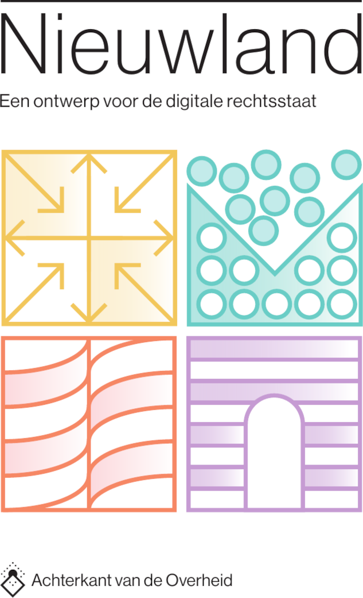

# Achterkant van de Overheid

Welkom bij de GitHub-organisatie van de **Denktank Achterkant van de overheid**.

Wij denken na over de juridische en informatiekundige grondslagen van een goed werkende digitale overheid: rechtstoestand, rechtszekerheid, contextgrenzen, herkomst van gegevens, en de vraag hoe wetgeving en uitvoering beter op elkaar aansluiten in een gedigitaliseerde samenleving.

## Nieuwland

**Nieuwland** is een ontwerp voor de digitale rechtsstaat — een positief ideaalbeeld dat laat zien hoe digitalisering kan bijdragen aan meer inzicht, beheersing en menselijkheid in overheidshandelen.

Nieuwland stelt de vraag: *hoe zou een gezonde, wenselijke digitale rechtsstaat eruit kunnen zien?* Het antwoord is geen utopie, maar een stap-voor-stap uitvoerbaar ontwerp — nieuw naast oud — gebouwd rond vier pijlers:

1. **Nieuwlands organiseren** — spreiding van informatiemacht tussen alle staatsmachten, burgers en samenleving
2. **Nieuwlands registreren** — scheiding van vastleggingen, interpretaties en besluiten
3. **Nieuwlands ontwerpen** — systemen ontworpen voor de werkelijke behoeften van alle belanghebbenden
4. **Nieuwlands normeren** — beheersing van informatiemacht als constitutionele opgave

> *"The past is written, but the future is left for us to write."*
> — Jean-Luc Picard

De publicatie is voortgekomen uit de [Denktank Achterkant van de Overheid](https://achterkantvandeoverheid.nl) en werd op 11 februari 2026 voor het eerst gepresenteerd aan Kamerleden.

## Chronolexografie

📖 **[Position Paper Chronolexografie](https://chronolexografie.nl/position-paper/)**: het conceptuele model en de architectuur voor het digitaal vastleggen en bijhouden van rechtstoestand, waarop Nieuwland voortbouwt. Ook beschikbaar als [PDF](https://chronolexografie.nl/position-paper/PositionPaperChronolexografie.pdf).

## Meer weten?

- 🌐 [achterkantvandeoverheid.nl](https://achterkantvandeoverheid.nl)
- 📚 [chronolexografie.nl](https://chronolexografie.nl/)
